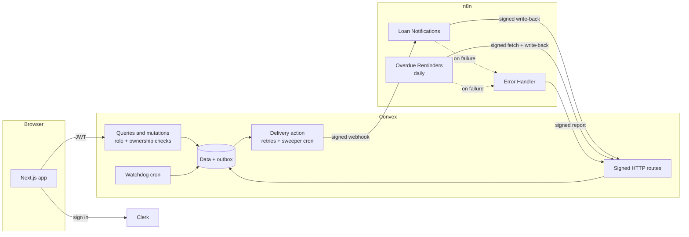

# LendLoop

**Borrow what you need. Lend what you don't.**

A neighborhood tool-lending board. Neighbors list tools, request to borrow from each other, and get automated notifications and overdue reminders through n8n.

**Stack:** Next.js 16 (App Router), Clerk, Convex, n8n, TypeScript.

## Contents

- [Local setup](#local-setup)
- [Environment variables](#environment-variables)
- [Trying it out](#trying-it-out)
- [Architecture](#architecture)
- [Security decisions](#security-decisions)
- [Data minimization](#data-minimization)
- [Reliability](#reliability)
- [Product decisions](#product-decisions)
- [Testing](#testing)
- [Running this in production](#running-this-in-production)

## Local setup

**You need:** Node 22, Docker, and a free [Clerk](https://clerk.com) application.

### 1. Install

```bash
npm install
cp .env.example .env.local
cp n8n/.env.example n8n/.env
```

### 2. Configure Clerk

1. In the Clerk dashboard, copy the API keys into `NEXT_PUBLIC_CLERK_PUBLISHABLE_KEY` and `CLERK_SECRET_KEY` in `.env.local`.
2. Under **Integrations**, activate **Convex**. This creates the JWT template named `convex`. If you create it by hand, it needs `aud: convex` plus the `name` and `email` claims.
3. Note your **Frontend API URL**, for example `https://your-app.clerk.accounts.dev`. You'll need it in the next step.

### 3. Start Convex

```bash
# A local backend, with no Convex account needed. PowerShell: $env:CONVEX_AGENT_MODE='anonymous'; npx convex dev
CONVEX_AGENT_MODE=anonymous npx convex dev
```

Leave this running. It writes the Convex URLs to `.env.local`, and its first push reports that `CLERK_JWT_ISSUER_DOMAIN` is missing. In a second terminal, set the Convex environment and it will retry on its own:

```bash
export CONVEX_AGENT_MODE=anonymous   # only for the local backend above
OUTBOUND=$(openssl rand -hex 32)
INBOUND=$(openssl rand -hex 32)

npx convex env set CLERK_JWT_ISSUER_DOMAIN https://your-app.clerk.accounts.dev
npx convex env set N8N_WEBHOOK_URL http://localhost:5678/webhook/lendloop-loan-events
npx convex env set N8N_WEBHOOK_SECRET "$OUTBOUND"
npx convex env set CONVEX_INBOUND_SECRET "$INBOUND"

echo "LENDLOOP_WEBHOOK_SECRET=$OUTBOUND"
echo "LENDLOOP_INBOUND_SECRET=$INBOUND"
echo "N8N_ENCRYPTION_KEY=$(openssl rand -hex 32)"
```

### 4. Start n8n

Put the three printed values into `n8n/.env`, then:

```bash
cd n8n && docker compose up -d
```

A one-shot `n8n-init` container imports and publishes all three workflows, so there's nothing to click. The editor is at <http://localhost:5678> if you want to look around. It asks you to create a local owner account on first visit.

> **Using a Convex cloud deployment instead?** It can't reach `localhost`. Run `docker compose --profile tunnel up -d`, find the URL with `docker compose logs tunnel`, and point `N8N_WEBHOOK_URL` at it. Set `N8N_PUBLIC_URL` to the same host, and set `CONVEX_SITE_URL` to `https://<deployment>.convex.site`.

### 5. Start the app

```bash
npm run dev
```

Open <http://localhost:3000>. (If that port is taken, use `npx next dev -p 3100`.)

### 6. Optional: demo data and an admin

```bash
npx convex run seed:demo    # sample tools, one overdue loan, one open request

# Sign in once first, then:
npx convex run users:setRole '{"email":"you@example.com","role":"admin"}'
```

Prefix these with `CONVEX_AGENT_MODE=anonymous` when using the local backend.

## Environment variables

| Variable | Where it's set | Purpose |
|---|---|---|
| `NEXT_PUBLIC_CONVEX_URL`, `CONVEX_DEPLOYMENT` | `.env.local` (written by `convex dev`) | Which Convex deployment to use |
| `NEXT_PUBLIC_CLERK_PUBLISHABLE_KEY`, `CLERK_SECRET_KEY` | `.env.local` | Clerk keys |
| `NEXT_PUBLIC_CLERK_SIGN_IN_URL`, `NEXT_PUBLIC_CLERK_SIGN_UP_URL` | `.env.local` | Clerk's in-app auth routes |
| `CLERK_JWT_ISSUER_DOMAIN` | Convex env | Issuer Convex trusts for tokens |
| `N8N_WEBHOOK_URL` | Convex env | Where loan events are sent |
| `N8N_WEBHOOK_SECRET` | Convex env | Signs Convex → n8n requests |
| `CONVEX_INBOUND_SECRET` | Convex env | Verifies n8n → Convex requests |
| `LENDLOOP_WEBHOOK_SECRET` | `n8n/.env` | Same value as `N8N_WEBHOOK_SECRET` |
| `LENDLOOP_INBOUND_SECRET` | `n8n/.env` | Same value as `CONVEX_INBOUND_SECRET` |
| `CONVEX_SITE_URL` | `n8n/.env` | Where n8n reaches Convex HTTP actions |
| `N8N_ENCRYPTION_KEY` | `n8n/.env` | Encrypts n8n's stored data |
| `N8N_PUBLIC_URL` | `n8n/.env` (optional) | n8n's public URL when tunneling |
| `LENDLOOP_SIMULATE_SEND_FAILURE` | `n8n/.env` (optional) | Makes the mock senders fail, for testing |

## Trying it out

**The happy path.** Sign in as two people (a second browser profile works). List a tool as one and request it as the other. Each step appears on the loan as it happens, for example "Request notice sent to lender · just now". The mock notifications go to the n8n log:

```bash
cd n8n && docker compose logs n8n | grep lendloop.
```

**Run the overdue workflow now**, without waiting for 08:00 UTC, with the demo data loaded. The extra port avoids a clash with the running instance's task broker:

```bash
cd n8n && docker compose exec -e N8N_RUNNERS_BROKER_PORT=5680 n8n n8n execute --id=LendLoopOverdue1
```

Run it twice. The second run sends nothing, because that loan already has today's reminder.

**Watch it fail safely.** Set `LENDLOOP_SIMULATE_SEND_FAILURE=true` in `n8n/.env`, run `docker compose up -d`, and make a request in the app. The attempt fails inside n8n and Convex backs off and retries. Each failure appears under **Admin → Automation**. Set it back to `false` and the pending notification is delivered on its next retry.

> CLI runs don't trigger n8n's error workflow, as n8n only does that for scheduled and webhook runs. To see an overdue-reminder failure reach the error workflow, let the schedule fire or temporarily change its cron expression.

## Architecture



**Layout**

```
app/                 Routes. (app)/ holds the signed-in pages
components/          UI
convex/
  schema.ts          Data model
  tools.ts loans.ts  User-facing functions
  admin.ts           Admin-only functions
  notifications.ts   Outbox delivery: claim, send, retry, sweep
  automation.ts      Overdue list, reminder write-backs, failure log, watchdog
  http.ts            Signed endpoints that n8n calls
  lib/functions.ts   userQuery / adminMutation etc: the authorization wrappers
  lib/signature.ts   HMAC signing and verification
n8n/
  docker-compose.yml n8n with automatic workflow import
  workflows/         The exported workflows
tests/               Access control, loan rules, automation, workflow contract
```

**The three workflows**

| Workflow | Trigger | What it does |
|---|---|---|
| Loan Notifications | Webhook | Verifies the signature, sends the (mock) notification, writes back to Convex, then answers 200. Bad signature: 401. Failure: 500, so Convex retries |
| Overdue Reminders | Daily 08:00 UTC | Fetches overdue loans, sends a reminder per loan, writes all results back, then fails the run if any reminder failed so the error workflow fires |
| Error Handler | Any failure in the above | Sends a scrubbed report to Convex and logs an alert to the container, which still works if Convex is down |

## Security decisions

**Authorization lives in Convex, and is hard to forget.** Client-callable functions that touch private data are built from `userQuery`, `userMutation`, `adminQuery` and `adminMutation` in [convex/lib/functions.ts](convex/lib/functions.ts), which authenticate before the handler runs. Ownership is then checked against the specific record. The UI's role checks and `proxy.ts` redirects are conveniences only; the tests call the functions directly to prove they hold without the UI.

**Admin is deliberately narrow.** Admins can remove listings, view all loans and mark Trusted Lenders, as specified. They can't edit someone's listing or approve loans on their behalf, because nothing requires it. Each admin action is written to an audit log.

**Roles can't be self-assigned.** `ensureCurrent` takes no arguments and always creates `user`. `setRole` is an `internalMutation`, unreachable from any client, and needs a deploy key. Identity comes only from the verified Clerk token, keyed on `tokenIdentifier`.

**Signed in both directions, with separate secrets.** Each direction has its own HMAC-SHA256 secret, so a leak of one doesn't compromise the other.

```
X-LendLoop-Signature: t=<unix seconds>,v1=<hex hmac>
signed string:        <t>.<METHOD>.<path>.<raw body>
```

- The **timestamp** gives a 5-minute replay window. Retries are re-signed, so they don't hit it.
- **Method and path** stop a signature for one endpoint being replayed on another.
- The **raw bytes** are verified, before parsing. Comparison is constant-time.
- Routes **fail closed**: a missing secret rejects everything rather than accepting it.

**No secrets in code or workflow exports.** Workflows read from `$env` and contain no credential references, which a test enforces. The Code nodes need `N8N_BLOCK_ENV_ACCESS_IN_NODE=false` for this, which is an accepted trade-off on a single-purpose instance. A shared instance should use n8n's credential store with an external secrets provider instead.

**Other hardening:** server-side input validation and length limits, per-user caps on listings and open requests, a body-size limit on HTTP routes, the n8n port bound to localhost, baseline security headers, and error messages that only expose text raised on purpose.

**A known limit.** A captured webhook could be replayed within the 5-minute window, which would resend that same notification to its intended recipient. It can't be altered or redirected. A store of seen signatures would close this, and it's on the production list.

## Data minimization

| Surface | What it can see | What it can't |
|---|---|---|
| Public page | Tool name, category | Owners, descriptions, loans. A `returns` validator makes extra fields an error |
| Signed-in board | Owner's first name, trust badge, booked dates | Emails, who booked a tool |
| Loan participants | Other party's first name, automation status | Emails, internal error text |
| Admin | Full names, loans, failure details | Emails, which aren't returned by any client-callable function |
| Webhook to n8n | Event ID and type, tool name, dates, recipient's email and first name | The other party's identity, internal IDs |
| Overdue feed to n8n | Reminder key, tool name, due date, days overdue, borrower's email and first name | Anything about the lender |

Further choices:

- The **outbox stores references, not personal data**. The payload is built when it's sent, so an address change is picked up and no copies pile up.
- The **Verify Signature node allowlists fields**, so anything extra in a request stops there.
- **Successful n8n runs aren't saved** (`saveDataSuccessExecution: none`), since they'd hold addresses. Failed runs are kept for debugging and expire after 7 days.
- **Logs mask addresses** (`b***@example.com`), and the error workflow scrubs addresses from messages and forwards metadata only.

## Reliability

**Outbox.** A notification row and its scheduled delivery are written in the same transaction as the status change, so neither can happen without the other.

**Retries.** Each delivery takes a lease, so the retry timer and the sweeper can't both send it. Failures back off over 30 seconds, 2, 10 and 30 minutes, up to 5 attempts, always with the same event ID. Admins can then see the failure and retry it. Because Convex scheduled actions don't retry on their own, a cron every 5 minutes recovers rows stranded by a crash.

**Idempotent write-backs.**

- *Reminders* upsert on `<loanId>:<date>`, a key Convex issues, so a run crossing midnight can't invent a new one. `sent` is final: a late `failed` can't overwrite it. Loans with a sent reminder today aren't listed again, so re-running a workflow sends nothing new.
- *Notifications* are acknowledged by event ID. If Convex's request times out but n8n finishes, the acknowledgement arrives first and the retry finds nothing to do.
- *Failure reports* are keyed on the execution ID.

**Delivery is at-least-once, on purpose.** For these messages, a rare duplicate is better than a lost notice. A duplicate needs the send to succeed and then both the write-back (with its retries) and the webhook response to fail.

**Failures can't go quiet.**

| What goes wrong | How it surfaces |
|---|---|
| A single call fails briefly | Node-level retries |
| Notification can't be sent | Webhook returns 500, Convex retries, the error workflow reports it |
| Attempts run out | Marked `failed` on the loan and in Admin, with a retry button |
| A reminder fails | Saved as `failed`, the run then fails on purpose, the error workflow reports it. Retried on the next run |
| Convex is down during reporting | The error workflow still logs an alert to the container |
| **n8n is down, so nothing runs at all** | The error workflow can't report this. A daily Convex watchdog notices the missing heartbeat and records a failure |

## Product decisions

- **Only the lender can mark a loan returned.** A borrower could otherwise silence their own overdue reminders. The spec left this open.
- **Listings are soft-deleted**, so loan history stays intact.
- **Owners can't remove a tool with an agreed loan.** Admins can, and then open requests are declined, upcoming loans cancelled, and a loan under way stays open because the tool still has to come back.
- **Approving a request auto-declines overlapping ones**, and tells those people right away.
- **"Available" means not out right now.** A tool booked for next month shows as available today, with its booked dates listed, and overlapping requests are refused.
- **Days are UTC.** Start dates get one day of grace so someone west of UTC isn't refused "today". Reminders go out the UTC day after the due date.

## Testing

```bash
npm test            # backend and workflow contract tests
npm run typecheck
npm run lint
```

The automated suite covers access control, loan rules, signing, retries, idempotency, and the exported workflow files. Those last tests run the actual Code node source against the Convex signing module, so the two sides can't silently drift apart.

The full stack was also exercised manually against a real Clerk dev instance, local Convex and n8n in Docker: a two-person browser flow, forged and unsigned webhooks, a simulated provider outage on both webhook and scheduled runs, and recovery afterwards. That browser run isn't part of `npm test`, because it needs live services.

## Running this in production

**Would change first**

- **Send real notifications.** Replace the mock nodes with an email provider through an n8n credential, and add an unsubscribe and notification preferences.
- **Add a way to arrange pickup.** Approved parties currently see only first names. I'd add in-app messaging, or share contact details by consent after approval.
- **Harden n8n.** Run it behind TLS with SSO, on Postgres with queue mode, and with `N8N_ENCRYPTION_KEY` and signing secrets in a secret manager. Expose only the one webhook path publicly. Pin and patch the image.
- **Real alerting.** Send error-workflow and watchdog failures to a pager or Slack, not only the Admin page and logs. Monitor outbox depth and age.

**Would change next**

- **Replay protection:** store recently seen signatures or event IDs.
- **Secret rotation:** accept two secrets during a rollover window.
- **User sync:** use Clerk webhooks, so account deletions and email changes propagate without a sign-in, and add a retention and erasure policy for loans and logs.
- **Rate limiting:** add it on mutations and at the edge, plus a Content Security Policy.
- **Scale:** replace per-tool availability lookups with a maintained field, and paginate the lists, which are currently capped. Batch overdue reminders beyond the 500-per-run cap.
- **Neighborhoods and time zones:** the board is one global group on UTC. Real use needs per-community scoping and local due dates.
- **Delivery:** separate dev, staging and prod deployments, CI running the tests, and browser tests against staging.
